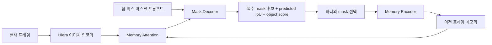
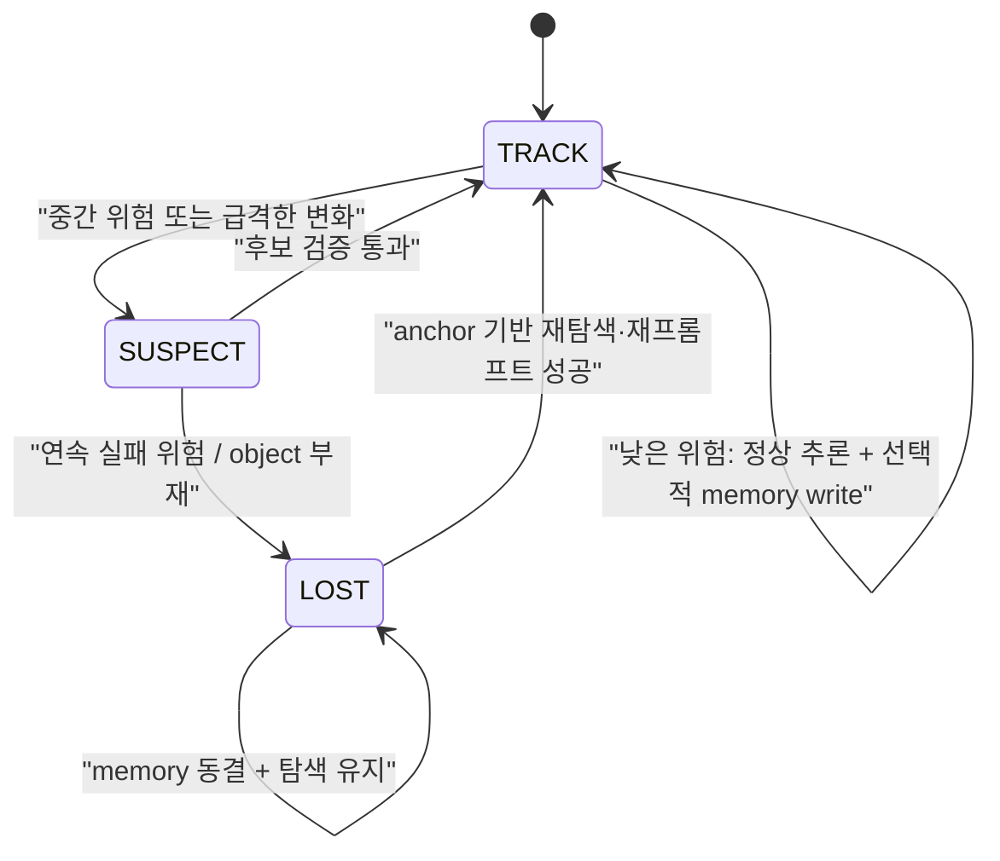

# SAM 2 성능 개선을 위한 선행연구 조사와 과제연구 설계안

> 조사 기준일: 2026-08-20  
> 중심 범위: SAM 2/SAM 2.1 기반의 프롬프트형 비디오 객체 분할(PVOS), 반지도 비디오 객체 분할(VOS), 객체 추적(VOT)  
> 핵심 질문: **SAM 2의 평균 정확도를 재는 데서 끝나지 않고, 어떤 실패 원인을 어떻게 고쳐야 실제 성능이 좋아지는가?**

## 0. 먼저 읽을 결론

1. 실험 기준선은 원본 SAM 2가 아니라 **공식 SAM 2.1**로 잡는 것이 맞다. 공식 저장소에는 개선된 체크포인트와 다중 객체별 독립 추론이 포함되어 있다. ([공식 코드·체크포인트](https://github.com/facebookresearch/sam2))
2. **장기/단기 이중 메모리**, **고정 신뢰도 임계값으로 메모리 선택**, **칼만 필터 추가**, **가림 시 메모리 동결**만으로는 신규성이 약하다. SAM2Long, DAM4SAM, SAMURAI, UAMP, HiM2SAM, OASAMT, Lean-SAM2, 그리고 2026-08-19 공개된 SAM2Dual까지 이미 이 공간을 상당 부분 차지했다.
3. 가장 추천하는 주제는 다음이다.

> **교차 데이터셋 신뢰도 보정에 기반한 SAM 2.1의 선택적 메모리 갱신과 오류 누적 억제**

이 주제의 차별점은 “신뢰도 값이 높으면 저장한다”가 아니다. **SAM 2의 내부 점수가 실제 오류 확률과 얼마나 맞는지 영상 단위·데이터셋 간에 검증·보정하고**, 보정된 실패 위험에 따라 메모리 쓰기와 보류를 결정하는 것이다. 상태 제어와 재탐색은 이 가설을 시험하는 응용 모듈이지 신규성의 중심으로 주장하지 않는다. 최종 J&F뿐 아니라 실패 검출 AUROC, calibration error, 잘못된 메모리 기록률, 가림 후 회복 시간까지 평가한다.

4. 두 번째로 좋은 선택은 **소형·얇은 객체를 위한 시간적으로 일관된 경계 보정**이다. SAM2Refiner가 공간적 세부 복원을 이미 다루므로, 단순 고해상도 decoder가 아니라 **motion-aligned temporal boundary consistency**로 범위를 좁혀야 한다.
5. 세 번째 선택은 **저조도·안개·비·모션블러에서 불확실성 기반 메모리 보호**다. CVPR 2026 RobustPVOS가 이 문제를 정식 벤치마크로 만들었으므로, 공개 데이터와 명확한 실패 조건을 사용할 수 있다.

---

## 1. 먼저 연구 범위를 정확히 고정하기

SAM 2 관련 논문은 겉으로 비슷해도 실제 과제가 다르다. 논문 성능을 비교할 때 아래 구분을 섞으면 안 된다.

| 구분 | 입력 | 출력/평가 | 이 문서에서의 역할 |
|---|---|---|---|
| 반지도 VOS | 보통 첫 프레임 정답 마스크 | 이후 프레임의 객체 마스크, J/F/J&F | **주 연구 범위** |
| Promptable VOS | 점·박스·마스크 및 중간 수정 | 마스크와 사용자 상호작용 횟수 | 주 연구 범위 |
| VOT | 첫 프레임 박스/마스크 | 단일 객체 위치·마스크, AUC/AO/Q | 메모리·가림 연구 참고 |
| MOT | 검출된 여러 객체 또는 질의 | 궤적·ID, HOTA/IDF1 | 다중 객체 확장 참고 |
| RVOS/VRS | 텍스트 또는 추론 문장 | 언어가 가리키는 객체 마스크 | 의미·재탐색 확장 참고 |
| 정적 이미지/의료 3D | 점·박스·support mask 등 | 한 장 또는 slice sequence의 mask | 경계·도메인 적응 참고 |

본 과제는 우선 **첫 프레임 마스크가 주어진 장기 VOS**로 고정하는 것이 가장 깔끔하다. 텍스트, 외부 검출기, 사용자 재클릭을 처음부터 모두 넣으면 무엇이 개선을 만들었는지 분리하기 어렵다.

### 문헌 상태 표기

- **[정식]** 학회 본회의 또는 저널 게재
- **[워크숍]** 학회 워크숍 게재
- **[프리프린트]** arXiv 등 공개 원고이며 동료심사 확정 전
- **[공식 구현]** 논문 게재와 별개인 공식 코드/체크포인트 공개

프리프린트는 최신 아이디어 중복 여부를 확인하는 데는 중요하지만, 확립된 결과처럼 인용하면 안 된다.

---

## 2. SAM 2가 실패하는 구조적 이유

[SAM 2 원 논문](https://proceedings.iclr.cc/paper_files/paper/2025/hash/45c1f6a8cbf2da59ebf2c802b4f742cd-Abstract-Conference.html)은 Hiera 이미지 인코더, 메모리 어텐션, 프롬프트/마스크 디코더, 메모리 인코더와 스트리밍 메모리를 결합한다. 이전 프레임의 예측이 다음 프레임의 조건으로 다시 들어가는 **자기회귀적 구조**이므로, 한 번의 실수가 이후 판단 자료까지 오염시킬 수 있다.

핵심 실패 지점은 다섯 가지다.

1. **탐욕적 후보 선택**: 모호한 프레임에서도 predicted IoU가 가장 높은 후보 하나를 고른다. 내부 점수가 틀리면 잘못된 mask가 바로 확정된다.
2. **오류의 메모리 기록**: 잘못 선택한 mask가 메모리로 들어가 다음 프레임을 오염시킨다. 단발성 오류가 drift나 identity switch로 변한다.
3. **FIFO와 짧은 시간 범위**: 최근 프레임은 현재 모습 적응에 좋지만, 긴 가림 뒤 원래 정체성을 되찾는 anchor로는 약하다.
4. **명시적 운동·상태 모델 부족**: 빠른 이동, 화면 밖 이탈, 가림/재등장 상태를 별도 동역학으로 다루지 않는다.
5. **객체 간 상호작용 부족**: 기본 구조는 여러 객체를 대체로 독립 처리한다. 비슷한 객체가 겹치면 mask 소유권과 identity가 충돌한다.

세부적으로는 작은 객체, 얇은 구조, 낮은 대비, 모션블러, 악천후에서 이미지 특징과 경계가 먼저 약해지고, 그 오류가 다시 시간축으로 증폭된다.

---

## 3. 가장 직접적인 선행연구 지도

### 3.1 장기 메모리, 오류 누적, 가림과 재등장

| 연구 | 상태 | 무엇을 바꿨나 | 핵심 성과/의미 | 남은 한계와 중복 주의 |
|---|---|---|---|---|
| [SAM2Long](https://openaccess.thecvf.com/content/ICCV2025/html/Ding_SAM2Long_Enhancing_SAM_2_for_Long_Video_Segmentation_with_a_ICCV_2025_paper.html) | [정식] ICCV 2025 | 여러 mask 경로를 유지하는 제한적 tree search, object-aware memory filtering/modulation | 12개 직접 비교 평균 +3.7점, 장기 benchmark 최대 +5.3 J&F. 탐욕 선택이 오류 누적의 원인임을 직접 공략 | 여러 경로만큼 연산·메모리 증가, 주로 단일 객체. “multi-hypothesis만 추가”는 이미 선행연구가 있음 |
| [DAM4SAM](https://openaccess.thecvf.com/content/CVPR2025/html/Videnovic_A_Distractor-Aware_Memory_for_Visual_Object_Tracking_with_SAM2_CVPR_2025_paper.html) | [정식] CVPR 2025 | Recent Appearance Memory와 Distractor Resolving Memory, introspection 기반 update | 유사 방해물에 특화한 DiDi dataset 제안, 7개 benchmark 중 6개 SOTA | VOT 중심. “negative/distractor memory” 자체는 이미 선행됨 |
| [SAMURAI](https://pubmed.ncbi.nlm.nih.gov/41528905/) | [정식] IEEE TIP 2026 | 칼만 운동 단서와 motion-aware mask/memory selection | LaSOT-ext AUC +7.1%, GOT-10k AO +3.5% 보고 | 선형 운동 가정. “SAM 2 + Kalman”은 독립 주제로는 이미 완료된 아이디어 |
| [SAM2Plus](https://www.mdpi.com/1424-8220/25/13/4199) | [정식] Sensors 2025 | Kalman motion, 동적 품질 threshold, motion·appearance 다중 기준과 제한된 adaptive memory | SA-V·LVOS의 24개 직접 비교 평균 +1.0 J&F, 최대 +2.3 보고 | motion+appearance heuristic gate도 이미 선행됨. 각 신호의 독립 기여와 threshold 전이성이 불명확 |
| [UAMP](https://journals.plos.org/plosone/article?id=10.1371/journal.pone.0353156) | [정식] PLOS ONE 2026 | appearance uncertainty, Kalman motion uncertainty, 장·단기 메모리 결합 | 5개 VOS benchmark에서 SAM 2 개선, 최대 +5.6 J&F 보고 | uncertainty와 dual memory 결합도 이미 존재. 확률 보정과 dataset 간 전이는 별도 검증되지 않음 |
| [OASAMT](https://www.sciencedirect.com/science/article/pii/S0031320326011209) | [정식] Pattern Recognition 2026 | TCN 기반 가림 상태 추론과 dual-memory bank | mask IoU, 면적 변화, confidence의 시간 패턴으로 가림을 명시적으로 모델링 | 가림 분류기+dual memory라는 조합도 선점됨 |
| [Prompt Self-Correction](https://www.mdpi.com/2079-9292/14/18/3602) | [정식] Electronics 2025 | object pointer 변화로 오류를 감지하고 particle-filter box와 negative points로 재추론 | 학습 없이 자동 재프롬프트 가능성을 보임 | 보고 향상폭은 작음. 단일 heuristic과 고정 임계값의 전이성 문제가 남음 |
| [MA-SAM2](https://papers.miccai.org/miccai-2025/0556-Paper2634.html) | [정식] MICCAI 2025 | context-aware memory와 occlusion-resilient memory | EndoVis 2017/2018에서 SAM 2 대비 +4.36/+6.1% | 수술 영상 특화. 일반 VOS와 같은 조건의 검증이 필요 |
| [HiM2SAM](https://arxiv.org/abs/2507.07603) | [정식] PRCV 2025 proceedings | Kalman coarse motion + 선택적 CoTracker3 비선형 refinement, 장·단기 메모리 | LaSOT/LaSOT-ext에서 SAM 2 대비 상대 AUC +9.6/+7.2% 보고 | offline point tracker와 여러 gate가 필요하고 VOT 중심. SAMURAI·UAMP와 큰 축이 겹침 |
| [SAMITE](https://arxiv.org/abs/2507.21732) | [프리프린트] 2025 | feature/position correctness 기반 prototype memory와 위치 프롬프트 생성 | 가림·방해물 프레임을 걸러 오류 전파를 차단 | “prototype score + position reprompt”도 이미 제안됨. 제목의 calibrated는 확률 calibration과 다름 |
| [SAM2RL](https://arxiv.org/abs/2507.08548) | [프리프린트/워크숍] 2025 | 메모리 update를 순차 의사결정으로 보고 강화학습으로 제어 | hand-crafted rule을 넘을 가능성 제시 | 현재 핵심 실험은 영상마다 별도 agent를 과적합한 설정. 영상 간 일반화 policy는 열려 있음 |
| [SENTRY](https://arxiv.org/abs/2606.24449) | [프리프린트] 2026 | mask 후보를 짧은 tracklet으로 되감아 cycle consistency를 확인한 뒤 memory에 기록 | 5개 SAM2 계열 baseline·9개 benchmark에서 일관된 향상 보고 | “refine-before-write”와 temporal consistency 검증까지 선점. 최신 원고라 독립 재현 필요 |
| [Lean-SAM2](https://arxiv.org/abs/2607.19811) | [프리프린트] 2026 | target anchor 기반 memory pruning, insurance memory, 위험 시 full-frame refresh | LVOSv2에서 1.41× 속도 향상과 J&F +5.0/+3.6 보고 | risk-aware fallback과 anchor memory가 이미 포함됨. 효율·정확도 수치의 외부 검증 전 |
| [SAM2Dual](https://arxiv.org/abs/2608.18640) | [프리프린트] 2026-08-19 | short/long dual memory와 early-frame text cue 기반 memory reweighting | MOSEv2 J&F 49.33→50.65, LVOSv2 82.1→83.1 보고 | 고정 주기 장기 memory write가 part-level target에서 오염됨. 논문 자체가 confidence/consistency/event-triggered update를 후속 과제로 제시 |
| [IMTrack](https://www.sciencedirect.com/science/article/pii/S0952197626018804) | [정식] EAAI 2026 | 신뢰 keyframe으로 재탐색용 implicit memory를 준비하고 loss 감지 시 local tracking에서 global re-detection으로 전환 | LaSOT success 최대 +3.0%, LaSOT-ext 최대 +8.8% 보고 | box recovery 중심이며 loss detector와 keyframe 품질에 의존. “전역 재탐색 추가” 자체는 이미 선행됨 |
| [StreamDAM](https://arxiv.org/abs/2608.03912) | [프리프린트] 2026-08-04 | 학습된 presence signal 하나로 memory write, read horizon, 출력 보류, 재탐색을 함께 제어하고 deadline-aware streaming으로 평가 | 4개 benchmark·5개 baseline에서 offline 성능 대부분을 회복했다고 보고 | 매우 최신 단독 저자 원고이며 외부 검증 전. **상태기계+재탐색 통합 자체도 더는 빈 공간이 아님** |

#### 여기서 얻는 결론

- 단순 FIFO 교체, 장·단기 bank, Kalman filter, confidence threshold, 가림 때 freeze, distractor bank, multi-hypothesis는 각각 이미 논문이 있다.
- 남은 핵심은 **어떤 신호를 믿을 것인가**, **그 신호가 데이터셋이 바뀌어도 믿을 만한가**, **언제 비싼 복구를 실행해야 하는가**다.
- 대부분의 방법은 자체 점수 또는 손으로 정한 임계값을 쓰고 최종 평균 J&F로 끝난다. **실패 위험의 calibration, 메모리 오염률, 가림 사건별 회복 과정**은 상대적으로 덜 정리되어 있다.

### 3.2 프롬프트, 언어, 의미 기반 재집중

| 연구 | 상태 | 핵심 아이디어 | 본 과제와의 관계 |
|---|---|---|---|
| [SAMWISE](https://openaccess.thecvf.com/content/CVPR2025/html/Cuttano_SAMWISE_Infusing_Wisdom_in_SAM2_for_Text-Driven_Video_Segmentation_CVPR_2025_paper.html) | [정식] CVPR 2025 | frozen SAM 2에 5M 미만 adapter로 언어·시간 정보를 주입하고 tracking bias를 감지해 refocus | 의미 단서가 잘못된 객체 고착을 풀 수 있음을 보임. 단, RVOS 과제 |
| [MPG-SAM 2](https://openaccess.thecvf.com/content/ICCV2025/html/Rong_MPG-SAM_2_Adapting_SAM_2_with_Mask_Priors_and_Global_ICCV_2025_paper.html) | [정식] ICCV 2025 | text-video encoder, dense mask prior, global-historical aggregator | 전역 문맥과 텍스트를 prompt/memory 양쪽에 넣는 큰 모델. 단순 text prompt 추가는 신규성이 약함 |
| [SAM2-LOVE](https://openaccess.thecvf.com/content/CVPR2025/html/Wang_SAM2-LOVE_Segment_Anything_Model_2_in_Language-aided_Audio-Visual_Scenes_CVPR_2025_paper.html) | [정식] CVPR 2025 | 텍스트와 오디오가 가리키는 객체를 계속 분할 | 다중 모달 대상 지정의 참고 사례이며 일반 VOS 성능 개선과는 구분해야 함 |
| [EntitySAM](https://openaccess.thecvf.com/content/CVPR2025/html/Ye_EntitySAM_Segment_Everything_in_Video_CVPR_2025_paper.html) | [정식] CVPR 2025 | 영상 속 모든 entity를 자동 발견하고 SAM 2로 추적 | 자동 프롬프트·새 객체 등장 처리에 참고 |
| [Segment Any Motion](https://openaccess.thecvf.com/content/CVPR2025/html/Huang_Segment_Any_Motion_in_Videos_CVPR_2025_paper.html) | [정식] CVPR 2025 | 장거리 trajectory와 DINO semantic feature를 SAM 2의 반복 point prompt로 변환 | 움직임 자체로 prompt를 만들 수 있으나 ‘주어진 대상 추적’과 ‘모든 움직이는 객체 분할’은 다른 과제 |
| [DC-SAM](https://pubmed.ncbi.nlm.nih.gov/41428908/) | [정식] IEEE TPAMI 2026 | positive/negative visual prompt와 cycle-consistent cross-attention으로 one-shot/in-context segmentation | 첫 프레임 visual exemplar를 재탐색 단서로 사용하는 설계에 참고 |
| [SeC](https://proceedings.iclr.cc/paper_files/paper/2026/hash/d3f48777432f64bc96b1203713f20352-Abstract-Conference.html) | [정식] ICLR 2026 | LVLM이 장면을 지나며 object-centric concept prior를 갱신하고 장면 전환 때 의미 특징을 주입 | SeCVOS에서 SAM2.1 58.2→70.0 J&F 보고. 강력하지만 4B급 의미 모델의 학습·추론 비용과 동일 범주 instance 구분 한계가 있음 |
| [LIT-LoRA](https://openaccess.thecvf.com/content/CVPR2026/papers/Yang_Live_Interactive_Training_for_Video_Segmentation_CVPR_2026_paper.pdf) | [정식] CVPR 2026 | 사용자 수정 때 online LoRA를 약 0.5초 학습해 같은 오류의 재발을 줄임 | 수정으로부터 학습하는 축은 이미 등장. 자동 실패 감지나 ‘어느 프레임을 수정할지’는 별도 연구 가능 |
| [SAM 3](https://ai.meta.com/research/publications/sam-3-segment-anything-with-concepts/) | [정식] ICLR 2026 | 텍스트·이미지 exemplar로 concept를 지정하는 open-vocabulary 검출+분할+추적 | SAM 2 연구의 범위 경계. “텍스트를 붙여 zero-shot 대상을 찾는다”만으로는 최신 기준 신규성이 부족함 |

### 3.3 다중 객체, identity와 객체 간 충돌

| 연구 | 상태 | 핵심 아이디어 | 남은 연구 공간 |
|---|---|---|---|
| [SAM2MOT](https://ojs.aaai.org/index.php/AAAI/article/view/37455) | [정식] AAAI 2026 | segmentation 중심 trajectory manager와 cross-object tracking logic | DanceTrack에서 +2.1 HOTA, +4.5 IDF1 보고. 여러 객체를 독립 처리하는 한계를 직접 다룸 |
| [SAMURAI++](https://openaccess.thecvf.com/content/CVPR2026F/html/Yang_Extending_Segment_Anything_Model_2_to_Multi-Object_Tracking_by_Optimizing_CVPRF_2026_paper.html) | [정식] CVPR Findings 2026 | tracking-by-detection/query 결합, bipartite matching, short-motion/long-instance hierarchical memory | 다중 객체 identity 보존과 detection miss 복구까지 포함 |
| [SAMIDARE](https://arxiv.org/abs/2604.22162) | [워크숍/프리프린트] 2026 | 밀집 스포츠에서 density-aware mask 재생성, 선택적 memory update, state-aware association | 특정 밀집 장면의 mask 충돌 처리 참고 |

객체 간 상호작용은 여전히 의미 있는 연구축이지만, 이제는 “SAM 2를 여러 객체에 반복 실행”이 아니라 **겹침 영역의 소유권, 가림 순서, 동일 외형 객체 사이 identity 배타성**처럼 더 구체적인 문제를 다뤄야 한다.

### 3.4 경계, 작은 객체와 세부 구조

| 연구 | 상태 | 핵심 아이디어와 결과 | 남은 한계 |
|---|---|---|---|
| [SAM2Refiner](https://openaccess.thecvf.com/content/ICCV2025/html/Yao_Towards_Fine-grained_Interactive_Segmentation_in_Images_and_Videos_ICCV_2025_paper.html) | [정식] ICCV 2025 | global-local cross-attention, prompt retargeting, 다중 scale cascade로 256→1024 mask refinement. 정적 세부 dataset 평균 SAM2-L 78.5/71.5 mIoU/mBIoU→93.1/88.9 | crop·고해상도 head 비용, 시간축 경계 flicker를 직접 최적화하지 않음 |
| [HQ-SAM 2](https://github.com/SysCV/sam-hq/tree/main/sam-hq2) | [공식 구현/베타] | 기존 HQ-SAM 학습 전략을 SAM 2에 확장. 공개 표에서 DAVIS는 개선되지만 MOSE 향상은 작음 | 논문 수준의 완결된 검증과 장기·가림 분석이 부족 |
| [Quantifying the Limits of Segmentation Foundation Models](https://openaccess.thecvf.com/content/WACV2026/html/Zhang_Quantifying_the_Limits_of_Segmentation_Foundation_Models_Modeling_Challenges_in_WACV_2026_paper.html) | [정식] WACV 2026 | tree-like 구조와 낮은 texture separability가 SAM/SAM 2/HQ-SAM의 성능을 체계적으로 낮춘다고 분석 | 진단 논문이며 해결법은 아님. 구조 난이도별 개선 검증의 근거가 됨 |
| [SAM2-WaveUNet](https://www.sciencedirect.com/science/article/pii/S0957417426010882) | [정식] ESWA 2026 | wavelet과 frequency fusion으로 해양 생물의 세부 경계를 복원 | 정적 이미지·Hiera-L 중심. temporal consistency가 없음 |

### 3.5 도메인 적응과 실제 환경 강건성

| 연구 | 상태 | 핵심 아이디어 | 해석 시 주의점 |
|---|---|---|---|
| [Biomedical SAM-2](https://openreview.net/pdf?id=xaPv4b8z2D) | [정식] NeurIPS 2024 | Hiera와 mask decoder를 생의학 영상에 미세조정, 2D/3D/video 통합 | 대규모 domain fine-tuning이며 경량 개선은 아님 |
| [SAM2-Adapter](https://openreview.net/pdf?id=iBoABx5wjA) | [워크숍] ICLR 2025 | frozen Hiera의 각 stage에 adapter를 넣어 위장·그림자·의료 등 prompt-free binary segmentation | raw SAM 2를 prompt 없이 쓴 baseline의 큰 향상폭을 표준 interactive 성능 향상으로 오해하면 안 됨 |
| [SAM2-UNet](https://arxiv.org/abs/2408.08870) | [정식/프리프린트 계열] | Hiera encoder+adapter+U-Net decoder | memory와 prompt encoder를 제거한 정적 semantic model이므로 SAM 2 비디오 추적 개선은 아님 |
| [Medical SAM 2](https://arxiv.org/abs/2408.00874) | [프리프린트] 2024 | confidence·cosine diversity·현재 frame relevance로 self-sorting memory | 대규모 학습비용. memory scoring 아이디어는 참고 가능 |
| [SAMed-2](https://papers.miccai.org/miccai-2025/0803-Paper2056.html) | [정식] MICCAI 2025 | temporal adapter와 confidence/similarity 기반 memory retrieval/replacement | 공식 심사에서도 baseline 공정성과 inference 설명 문제가 지적됨 |
| [OFL-SAM2](https://ojs.aaai.org/index.php/AAAI/article/view/37502) | [정식] AAAI 2026 | frozen SAM 2와 online few-shot learner를 adaptive fusion | 소수 mask label과 test-time update가 필요 |
| [CamSAM2](https://arxiv.org/abs/2503.19730) | [정식] NeurIPS 2025 | frozen SAM 2에 object-aware fusion과 prototype을 넣어 camouflage video를 분할 | 위장 객체 특화지만 낮은 대비·identity 단서 연구에 유용 |
| [M4-SAM](https://openaccess.thecvf.com/content/CVPR2026/html/Liu_M4-SAM_Multi-Modal_Mixture-of-Experts_with_Memory-Augmented_SAM_for_RGB-D_Video_Salient_CVPR_2026_paper.html) | [정식] CVPR 2026 | RGB-D MoE-LoRA, 다중 scale fusion, prompt-free pseudo initialization | 깊이 센서가 필요한 별도 task |
| [RobustPVOS / MoGA](https://openaccess.thecvf.com/content/CVPR2026/html/Lee_Robust_Promptable_Video_Object_Segmentation_CVPR_2026_paper.html) | [정식] CVPR 2026 | 안개·비·눈·야간·저조도·모션블러를 포함하는 RobustPVOS benchmark와 object-memory-conditioned adaptation | 입력 손상 강건성의 최신 기준. calibration과 recovery policy 자체는 중심이 아님 |
| [RUAC](https://hongyouzhou.github.io/ruac/) | [정식] ICML 2026 | SAM2의 mask-level confidence confusion을 지적하고 Bayesian decoder와 uncertainty–accuracy alignment로 domain shift의 pixel uncertainty를 개선 | **calibration 연구의 가장 가까운 인접 선행연구**. 정적/개별 mask의 pixel uncertainty가 중심이며, video memory admission과 오류 전파 제어는 다루지 않음 |

### 3.6 속도·메모리 효율

| 연구 | 상태 | 핵심 아이디어와 결과 | 본 과제에 주는 힌트 |
|---|---|---|---|
| [EdgeTAM](https://openaccess.thecvf.com/content/CVPR2025/html/Zhou_EdgeTAM_On-Device_Track_Anything_Model_CVPR_2025_paper.html) | [정식] CVPR 2025 | RepViT와 Spatial Perceiver, feature distillation. iPhone 15 Pro Max 16 FPS 보고 | 대규모 재학습이 필요하므로 비교 대상으로 적합 |
| [Efficient Track Anything](https://openaccess.thecvf.com/content/ICCV2025/html/Xiong_Efficient_Track_Anything_ICCV_2025_paper.html) | [정식] ICCV 2025 | lightweight ViT와 효율적 memory module | Hiera-B+ 유사 성능에서 약 1.6× 속도, 2.4× 적은 parameter 보고 |
| [Q-MiniSAM2](https://www.ijcai.org/proceedings/2025/204) | [정식] IJCAI 2025 | post-training quantization, 계층적 video calibration, 유사 frame 간 mutual-KV | 양자화 오차와 temporal redundancy를 함께 다룸 |
| [Efficient-SAM2](https://proceedings.iclr.cc/paper_files/paper/2026/hash/aaa0ac4253da75faf9b0dc0dda062612-Abstract-Conference.html) | [정식] ICLR 2026 | object-aware Sparse Window Routing과 Sparse Memory Retrieval | SAM2.1-L에서 SA-V test 정확도 약 1%p 손실로 1.68× speedup 보고 |
| [TinySAM 2](https://arxiv.org/abs/2605.18013) | [프리프린트] 2026 | memory quality 관리, 시공간 token 압축, RepViT | SAM2.1 성능의 90%를 7% memory token과 3% training data로 유지한다고 보고 |
| [Lean-SAM2](https://arxiv.org/abs/2607.19811) | [프리프린트] 2026 | 효율화와 anchor/insurance memory, 위험 시 dense fallback을 함께 설계 | “빠르면서도 어려운 순간에는 계산을 되돌린다”는 방향의 직접 선행연구 |

효율화 연구를 택한다면 단순 FPS 비교보다 **위험할 때만 dense 경로를 쓰는 adaptive computation**이 더 흥미롭다. 다만 Lean-SAM2와 구분하려면 위험 점수의 calibration이나 명확한 compute budget 최적화가 필요하다.

### 3.7 추가로 확인한 직접·인접 연구

아래 연구는 최우선 비교군은 아니지만, 주제를 좁힐 때 중복 여부를 반드시 확인해야 한다.

| 연구 | 상태·범위 | 확인해야 할 아이디어 |
|---|---|---|
| [Rethinking Memory Design in SAM-Based VOT](https://arxiv.org/abs/2512.22624) | [프리프린트] 2025 | memory 설계를 admission/retention/read 관점으로 통합 분석하고 short appearance/long distractor memory를 구분. 원고가 일부 결과를 finalizing 중이라고 밝힘 |
| [SurgSLOT](https://arxiv.org/abs/2511.16618) | [프리프린트] 2025/26 | 수술 도구의 semantic identity와 long-term memory로 장기 부재 뒤 재식별 |
| [ReSurgSAM2](https://papers.miccai.org/miccai-2025/0774-Paper0617.html) | [정식] MICCAI 2025 | text-referred detection으로 신뢰 초기 frame을 찾고 diversity-driven long-term memory 구성 |
| [TSMS-SAM2](https://pmc.ncbi.nlm.nih.gov/articles/PMC12830041/) | [정식/공개 원문] 수술 영상 | multi-temporal-scale sampling과 memory splitting/pruning으로 빠른 운동과 중복 memory 대응 |
| [SAM2Text](https://openaccess.thecvf.com/content/CVPR2026/papers/Zhang_SAM2Text_Towards_Prompt-Free_and_Multi-Resolution_Video_Scene_Text_Segmentation_CVPR_2026_paper.pdf) | [정식] CVPR 2026, 장면 문자 | self-prompting, 256/512/1024 decoder, short-term+top-k memory. 범용 객체가 아닌 text segmentation |
| [AL-Ref-SAM 2](https://ojs.aaai.org/index.php/AAAI/article/view/32387) | [정식] AAAI 2025, audio/language RVOS | GPT가 pivot frame/box를 고르고 Grounding DINO와 SAM 2로 전파. 초기 prompt frame 선택 연구에 참고 |
| [CoT-RVS](https://openreview.net/pdf?id=1RgXNloctI) | [정식] ICLR 2026, reasoning VOS | MLLM이 CoT로 keyframe·description을 고르고 SAM 2가 양방향 전파. training-free지만 대형 모델 필요 |
| [Refer-Agent](https://openaccess.thecvf.com/content/CVPR2026/html/Jiang_Refer-Agent_A_Collaborative_Multi-Agent_System_with_Reasoning_and_Reflection_for_CVPR_2026_paper.html) | [정식] CVPR 2026, RVOS | 여러 agent의 reasoning/reflection으로 대상 후보와 empty-mask 가능성을 검증 |
| [StreamingRVOS](https://openaccess.thecvf.com/content/CVPR2026/html/Zhang_Towards_Streaming_Referring_Video_Segmentation_via_Large_Language_Model_CVPR_2026_paper.html) | [정식] CVPR 2026, RVOS | mask가 불안정할 때만 MLLM의 semantic embedding을 갱신하는 event-triggered 의미 보정 |
| [MSRTrack](https://openaccess.thecvf.com/content/WACV2026/html/Shen_MSRTrack_LLM-Powered_Object_Tracking_with_Motion_and_Semantic_Reasoning_WACV_2026_paper.html) | [정식] WACV 2026, VOT | VLLM이 구별 속성을 추출하고 motion·semantic reasoning으로 대상 소실 복구와 distractor 거절 |
| [OpenWorldSAM](https://papers.nips.cc/paper_files/paper/2025/hash/32fa3ddb3a6350cd1ab68e25f1c59982-Abstract-Conference.html) | [정식] NeurIPS 2025, 이미지 | frozen SAM 2와 VLM에 소형 adapter를 붙인 language-prompt universal image segmentation. temporal identity는 미검증 |
| [SAM-I2V](https://openaccess.thecvf.com/content/CVPR2025/html/Mei_SAM-I2V_Upgrading_SAM_to_Support_Promptable_Video_Segmentation_with_Less_CVPR_2025_paper.html) | [정식] CVPR 2025, **SAM 1 확장** | memory filtering과 memory-as-prompt를 적은 학습비용으로 구현. SAM 2 직접 개조로 분류하면 안 됨 |
| [SAMEO](https://openaccess.thecvf.com/content/CVPR2025/html/Tai_Segment_Anything_Even_Occluded_CVPR_2025_paper.html) | [정식] CVPR 2025, 정적 amodal segmentation | 가려져 보이지 않는 부분까지 형태를 예측. 시간 memory나 재등장 tracker는 아님 |
| [UncertainSAM](https://proceedings.mlr.press/v267/kaiser25a.html) | [정식] ICML 2025, SAM 계열 uncertainty | prompt·model·task ambiguity를 분리한 경량 post-hoc uncertainty. video memory action으로 연결하는 참고점 |

이 목록의 역할은 모델을 모두 구현하라는 뜻이 아니다. **문제 정의가 겹치는지 확인하고, 직접 비교할 3~5개 방법을 고르는 용도**다.

---

## 4. 선행연구가 이미 차지한 영역과 남은 공백

| 아이디어 | 포화도 | 대표 선행연구 | 그대로 하면 약한 이유 | 아직 가능한 좁은 질문 |
|---|---:|---|---|---|
| FIFO를 장·단기 메모리로 변경 | 매우 높음 | UAMP, HiM2SAM, OASAMT, SAMURAI++, SAM2Dual | 구조 자체가 반복됨 | 고정 주기가 아닌 **확률적으로 보정된 write 정책** |
| 칼만 필터/운동 점수 | 매우 높음 | SAMURAI, UAMP, HiM2SAM | 구현이 단순해 이미 여러 논문이 사용 | 비선형 운동에서 언제 motion을 버려야 하는지 calibration |
| predicted IoU가 높을 때만 저장 | 높음 | SAM2Long, DAM4SAM, MA-SAM2, SAMITE | 내부 점수가 실제 정확도와 맞는다는 가정 | dataset shift에서 confidence–accuracy 불일치를 측정·보정 |
| 여러 mask 후보 유지 | 높음 | SAM2Long, SENTRY | tree/tracklet 방식이 이미 강함 | 후보 수를 위험과 계산 예산에 따라 동적으로 결정 |
| 오류 시 자동 재프롬프트·전역 재탐색 | 높음 | Prompt Self-Correction, SAMITE, IMTrack, StreamDAM | heuristic trigger, local/global 전환과 위치 생성이 이미 있음 | **보정된 위험의 품질과 안전한 abstention**을 중심 질문으로 설정 |
| distractor/negative memory | 높음 | DAM4SAM | 유사 객체 특화 memory가 이미 있음 | 다중 객체 간 배타적 mask ownership/occlusion graph |
| text로 대상 재확인 | 중상 | SAMWISE, MPG-SAM2, SAM2Dual, SAM 3 | open-vocabulary 자체는 최신 모델이 강함 | instance-level visual anchor와 category text의 충돌 해소 |
| 고해상도 경계 head | 중상 | HQ-SAM2, SAM2Refiner | 공간 refinement만으로는 차별화 부족 | optical flow 정렬 후 **시간축 boundary consistency** |
| corruption/domain adapter | 중상 | SAM2-Adapter, MoGA, 각종 의료 모델 | 특정 dataset fine-tuning 논문이 많음 | unseen corruption에서 uncertainty calibration과 safe memory |
| 상태 기반 통합 memory controller | 중상 | OASAMT, StreamDAM | 보임/불확실/부재 상태와 행동 연결이 이미 제안됨 | dataset 간 calibration과 위험 상한을 갖는 정책 |
| 학습형 memory controller | 낮음~중간 | SAM2RL | 일반화하는 policy는 아직 미완성 | 여러 영상에 통하는 constrained/offline RL controller |

### 가장 명확한 연구 공백

#### 공백 A — SAM 2 내부 신뢰도의 확률적 보정

대부분은 predicted IoU, object-presence score, mask stability를 그대로 쓰거나 고정 임계값으로 자른다. 그러나 “score 0.8”이 실제로 “정확할 확률 80%”인지, MOSE에서 정한 threshold가 LVOS나 악천후 영상에서도 통하는지는 별개다. ICML 2026 [RUAC](https://hongyouzhou.github.io/ruac/)가 domain shift에서 SAM2의 mask-level confidence confusion을 직접 보였지만, 주 대상은 정적 mask의 pixel uncertainty이며 **그 불확실성을 video memory write와 미래 drift 위험에 연결하는 문제**는 남는다.

#### 공백 B — 평균 J&F가 숨기는 실패와 복구 과정

같은 J&F라도 한 방법은 잠깐 틀렸다 바로 복구할 수 있고, 다른 방법은 한 번 drift한 뒤 끝까지 실패할 수 있다. 가림 시작, 재등장, identity switch를 사건 단위로 나눈 평가가 필요하다.

#### 공백 C — 위험에 비례한 계산과 행동

모든 프레임에서 tree search나 global detector를 실행하면 비싸다. 평상시에는 SAM 2.1을 그대로 쓰고, 위험이 커질 때만 후보 검증·재탐색을 켜는 정책이 필요하다. 다만 StreamDAM과 Lean-SAM2가 이미 event/risk-based 호출을 제안했으므로, **event-trigger 자체가 아니라 잘 보정된 위험도와 정확도–계산비용 보장**이 연구의 차별점이어야 한다.

---

## 5. 최우선 추천 연구안

### 5.1 제목 후보

**한국어**  
교차 데이터셋 신뢰도 보정에 기반한 SAM 2.1의 선택적 메모리 갱신과 오류 누적 억제

**영어**  
Cross-Dataset Calibrated Risk Control for Selective Memory Updates in Long-Term Video Object Segmentation with SAM 2.1

### 5.2 한 문장 연구 주장

> SAM 2.1의 원시 내부 점수를 그대로 신뢰하지 않고 현재 또는 가까운 미래의 실제 실패 확률로 보정한 뒤, 그 위험에 따라 메모리 기록을 선택하면, 고정 임계값 방법보다 데이터셋이 바뀌어도 메모리 오염과 장기 drift를 더 안정적으로 줄일 수 있다.

### 5.3 연구 질문

- **RQ1.** predicted IoU, object-presence score, mask stability는 실제 mask 오류를 얼마나 잘 예측하며 dataset이 바뀌면 얼마나 miscalibrated 되는가?
- **RQ2.** 여러 신호를 결합해 보정한 실패 위험이 단일 confidence보다 잘못된 memory write를 더 잘 막는가?
- **RQ3.** 보정된 위험에 따라 memory write를 보류하면 미래 5~10프레임 안의 drift 확률과 가림·재등장 후 recovery가 개선되는가?
- **RQ4.** 한 dataset에서 정한 정책이 다른 dataset과 영상 손상 조건에서도 유지되는가?
- **RQ5.** 정확도 향상에 필요한 추가 계산량은 얼마이며, 항상 실행하는 multi-hypothesis 방식보다 효율적인가?

### 5.4 입력 신호

처음부터 모든 신호를 넣지 말고 다음 순서로 ablation한다.

1. **SAM 2 내부 신호**
   - predicted IoU
   - object-presence logit
   - mask stability score
   - 3개 mask 후보의 score margin과 mask 간 disagreement
2. **시간 일관성 신호**
   - 이전 mask와 현재 mask의 IoU
   - mask 면적·중심점·종횡비 변화율
   - 단순 constant-velocity 예측과 현재 mask의 residual
3. **정체성 신호**
   - 현재 object pointer와 첫 프레임/신뢰 anchor pointer의 cosine similarity
   - 선택 사항: DINOv2 feature prototype과 현재 대상 feature의 거리
4. **비싼 검증 신호 — 위험 frame에서만**
   - forward/backward propagation consistency
   - optical-flow warp 후 mask IoU
   - 2~3개 후보의 짧은 tracklet consistency

### 5.5 신뢰도 보정

정답 mask가 있는 개발 split에서 두 종류의 실패 label을 만든다. 현재 frame 실패는 `IoU < 0.5`, identity switch, 또는 대상이 있는데 empty mask인 경우다. 미래 위험은 **현재 mask를 memory에 쓴 뒤 5~10프레임 안에 지속 실패가 발생하는지**로 정의한다. 후자가 단순 mask 품질 예측을 넘어 memory admission 연구로 만드는 핵심이다.

비교할 방법은 다음이면 충분하다.

- raw score 또는 수작업 weighted sum
- logistic regression
- temperature scaling
- isotonic regression
- 선택 사항: conformal risk control로 허용 memory contamination risk `α`에 맞춘 threshold

중요한 것은 복잡한 network가 아니라 **held-out 영상과 다른 dataset에서 calibration이 유지되는지**, 그리고 정한 risk budget을 실제로 지키는지다. frame을 무작위로 섞어 train/test하면 같은 영상의 인접 frame이 누수되므로, 반드시 video 단위로 분할한다.

### 5.6 3상태 제어기

이 제어기는 실험을 수행하기 위한 최소 구현이다. OASAMT와 StreamDAM 때문에 **3상태 구조 그 자체를 논문의 주 기여로 내세우지는 않는다.** 동일한 상태 구조에서 raw threshold와 calibrated risk를 바꿔 성능 차이를 검증하는 것이 목적이다.

- **TRACK**: SAM 2.1 정상 추론. 보정된 성공확률이 높고 anchor와 충분히 일치할 때만 자동 예측을 memory에 쓴다.
- **SUSPECT**: 현재 예측을 memory에 쓰지 않는다. 복수 후보 또는 짧은 양방향 consistency로 후보를 재검증한다.
- **LOST**: 최근 prediction memory를 동결한다. 첫 프레임과 고신뢰 anchor를 이용해 global 후보를 찾고 box/mask prompt로 SAM 2.1을 다시 시작한다.

초기 과제에서는 short/long bank를 새로 설계하지 않아도 된다. **기본 memory의 write 허용/보류와 anchor slot 몇 개**만으로 시작해야 calibration 효과를 분리해 볼 수 있다.

### 5.7 이 연구가 기존 방법과 다른 지점

| 기존 방법 | 주요 기준 | 제안 연구의 구분점 |
|---|---|---|
| SAM2Long | predicted IoU·occlusion score로 경로 누적 | score 자체의 calibration과 dataset 간 전이를 평가 |
| DAM4SAM | distractor introspection과 두 memory | 일반 실패 확률과 memory 오염의 정량 관계를 모델링 |
| SAMURAI/UAMP | motion+appearance uncertainty | motion model 추가가 아니라 여러 신호의 확률적 신뢰도 정렬이 중심 |
| Prompt Self-Correction | pointer EMA와 particle-filter 재프롬프트 | 고정 heuristic 대신 보정된 위험과 상태에 따른 행동 선택 |
| SENTRY | tracklet cycle consistency로 write 검증 | 모든 검증 신호를 동일하게 쓰지 않고 위험도·예산에 따라 단계적으로 호출 |
| Lean-SAM2 | anchor 기반 pruning과 risk-aware dense refresh | encoder 효율이 아니라 failure probability와 recovery outcome이 중심 |
| SAM2Dual | 고정 주기 dual memory와 text reweighting | 고정 주기 write가 아니라 calibrated event-triggered write; 논문이 밝힌 failure case를 직접 공략 |
| StreamDAM | learned presence 하나로 write/read/abstain/re-detect 통합 | 상태 제어가 아니라 **score calibration, cross-dataset transfer, risk budget 준수**가 중심 |
| RUAC | domain shift에서 pixel-wise uncertainty–accuracy alignment | 정적 mask uncertainty를 video의 memory admission과 미래 drift 확률로 연결 |

**중요:** “calibration-aware controller가 최초”라고 미리 단정하면 안 된다. 2026년 프리프린트가 빠르게 추가되고 있으므로, 구현 범위를 확정한 날에 제목·초록·코드 수준으로 novelty search를 한 번 더 해야 한다. 현재 문헌 기준으로 가장 방어하기 쉬운 기여는 새 상태기계를 만들었다는 주장이 아니라, **미래 memory contamination 위험의 보정, dataset 간 전이, 정해진 위험 상한 아래의 성능 향상**이다.

---

## 6. 실험 설계

### 6.1 기준 모델과 비교군

최소 비교군:

1. SAM 2.1 동일 크기 checkpoint
2. SAM 2.1 + raw confidence threshold memory gate
3. SAM 2.1 + calibrated risk memory gate
4. SAM 2.1 + calibrated gate + event recovery
5. 공개 구현이 안정적이면 SAM2Long
6. 연구축에 따라 SAMURAI 또는 DAM4SAM 중 하나

모든 방법에서 checkpoint, 영상 해상도, 첫 프레임 prompt 형식, 객체 수 처리 방식, forward/backward propagation 여부를 고정해야 한다.

### 6.2 데이터셋

| 데이터셋 | 쓰는 이유 | 권장 용도 |
|---|---|---|
| [MOSEv2](https://mose.video/) | 가림, 소형·밀집 객체, 재등장, 저조도, 악천후, multi-shot, camouflage가 포함된 매우 어려운 현실 조건 | 핵심 평가. 전체가 크면 validation의 사건 표본을 층화 추출 |
| [LVOS v2](https://lingyihongfd.github.io/lvos.github.io/) | 긴 영상과 큰 시간 간격, 재등장 | 장기 drift와 threshold 전이 평가 |
| [DiDi](https://github.com/jovanavidenovic/DAM4SAM) | 유사 방해물이 많은 단일 객체 tracking | identity switch와 false reacquisition 분석 |
| [RobustPVOS](https://sohyun-l.github.io/RobustPVOS_project_page/) | 실제/합성 악천후·저조도·blur | domain shift calibration 실험의 선택 dataset |
| [Long-RVOS](https://isee-laboratory.github.io/Long-RVOS) | 2,193개 장기 referring 영상, 가림·재등장·shot change와 temporal/video IoU 제공 | 텍스트 확장 또는 장기 사건 평가의 선택 dataset. 기본 VOS와 prompt protocol은 구분 |
| [DAVIS 2017](https://davischallenge.org/) | 작고 익숙하며 평가 도구가 안정적 | 구현 sanity check. 최종 성능 주장은 DAVIS만으로 하지 않음 |
| [SA-V](https://ai.meta.com/datasets/segment-anything-video/) | SAM 2의 공식 대규모 분포 | 여유가 있으면 val subset. full train은 필수 아님 |

추천 조합은 **MOSEv2 + LVOS v2**, 그리고 DAVIS는 디버깅 전용이다. calibration은 MOSE 일부에서 학습하고 LVOS에서 그대로 평가한 뒤, 반대 방향도 해보는 cross-dataset 실험이 핵심이다.

### 6.3 성능 지표

#### 표준 mask 품질

- Region Jaccard `J`
- Boundary F-measure `F`
- `J&F = (J + F) / 2`

#### 실패 검출과 calibration

- failure AUROC, AUPRC
- Expected Calibration Error(ECE)
- Brier score
- risk–coverage curve: 위험 frame을 보류할수록 남은 prediction 정확도가 어떻게 변하는가

#### 시간축과 복구

- memory contamination rate: 실제 IoU가 기준 이하인 mask가 memory에 기록된 비율
- drift rate 또는 identity switch rate
- disappearance/reappearance event별 recovery success
- frames-to-recover: 재등장 후 정상 IoU로 돌아오는 데 걸린 frame 수
- false reacquisition: 다른 유사 객체를 목표로 잘못 복구한 비율
- longest failure streak

#### 비용

- FPS와 영상당 처리 시간
- peak VRAM
- SUSPECT/LOST trigger 비율
- 추가 후보 평가 횟수, global recovery 호출 횟수

### 6.4 핵심 ablation

| 실험 | 답하려는 질문 |
|---|---|
| predicted IoU만 사용 | SAM 2 내부 품질 head만으로 충분한가? |
| + object score/stability | 내부 신호 조합이 실패 검출을 높이는가? |
| + mask 후보 disagreement | 모호성을 명시하면 위험 예측이 좋아지는가? |
| + temporal change | 갑작스러운 motion/면적 변화가 추가 정보를 주는가? |
| + anchor similarity | 유사 객체로의 identity jump를 잡는가? |
| raw threshold vs calibrated threshold | 확률 보정이 실제 policy를 개선하는가? |
| write gate만 | 메모리 오염 차단만으로 얻는 이득은 얼마인가? |
| recovery만 | 재탐색 자체의 효과는 얼마인가? |
| gate + recovery | 둘의 상호보완 효과가 있는가? |
| fixed vs event-triggered expensive check | 같은 계산 예산에서 어느 쪽이 좋은가? |

### 6.5 통계 검증

- frame별 표본을 독립이라고 가정하지 말고 **sequence 단위 paired bootstrap 95% 신뢰구간**을 사용한다.
- 가능하면 sequence별 J&F 차이에 Wilcoxon signed-rank test를 추가한다.
- recovery metric은 가림/재등장 **event 단위 bootstrap**을 쓴다.
- threshold와 calibration model을 평가 split에 맞춰 조정하지 않는다.

### 6.6 성공 기준 예시

다음은 연구 시작 전에 정하는 목표이지, 결과를 보장하는 수치가 아니다.

- raw score 대비 failure AUPRC와 ECE가 유의하게 개선
- SAM 2.1 대비 MOSE/LVOS의 J&F 개선
- memory contamination rate 20% 이상 상대 감소
- 재등장 사건의 median recovery delay 감소
- false reacquisition 증가 없이 개선
- 전체 frame 중 20% 미만에서만 비싼 검증을 호출해 계산 증가 제한

---

## 7. 차선 연구안 세 가지

### 연구안 B — 소형·얇은 객체의 시간 일관적 경계 보정

**질문:** SAM2Refiner식 공간 refinement 뒤에도 남는 frame 간 boundary flicker를 motion-aligned loss 또는 inference-time refinement로 줄일 수 있는가?

- 입력: SAM 2.1 mask logit, Hiera의 고해상도 중간 feature, 이전 frame boundary
- 방법: optical flow로 이전 boundary를 warp하고, uncertainty가 큰 좁은 band만 작은 refinement head로 재예측
- 평가: mBIoU, Boundary F, temporal boundary consistency, small-object J&F, FPS
- 비교: SAM 2.1, HQ-SAM2, SAM2Refiner, 단순 morphology/CRF
- 장점: 결과 시각화가 분명하고 실패 원인이 구체적
- 위험: SAM2Refiner 학습 비용이 크므로 전체 모델 복제 대신 작은 boundary head만 설계해야 함

### 연구안 C — 악조건에서 안전한 memory

**질문:** 밝기·blur·비/안개가 급변할 때 corruption-aware uncertainty로 memory write를 막고 clean anchor를 보존하면 RobustPVOS 성능이 오르는가?

- CVPR 2026 RobustPVOS의 corruption benchmark 사용
- brightness, contrast, blur, rain severity와 SAM 2 confidence 오류의 관계 분석
- 작은 corruption encoder 또는 통계량으로 위험을 추정해 memory gate
- 핵심은 전처리로 화면을 밝게 만드는 것이 아니라 **나쁜 관측이 장기 memory를 오염시키지 않게 하는 것**
- clean→corrupt→clean 구간의 recovery를 별도 측정

### 연구안 D — 다중 객체 가림 그래프

**질문:** 각 객체를 독립 처리하는 SAM 2.1에 mask overlap, depth/area ordering, object-pointer exclusivity를 이용한 occlusion graph를 추가하면 유사 객체의 identity switch를 줄일 수 있는가?

- node: 객체 track, edge: 겹침·가림 가능성
- 동일 pixel을 여러 객체가 차지할 때 confidence만으로 합치지 않고 가림 순서와 identity anchor로 소유권 결정
- SAM2MOT·SAMURAI++와 직접 비교가 필요
- 신규성 잠재력은 높지만 구현과 annotation 분석 난도가 가장 높음

### 선택표

| 연구안 | 신규성 잠재력 | 구현 난도 | 결과 해석 | 학기 과제 적합도 |
|---|---:|---:|---:|---:|
| A. Calibration-aware memory/recovery | 높음 | 중 | 매우 좋음 | **1순위** |
| B. Temporal boundary refinement | 중상 | 중 | 매우 좋음 | **2순위** |
| C. Corruption-safe memory | 중상 | 중 | 좋음 | **3순위** |
| D. Multi-object occlusion graph | 높음 | 높음 | 좋음 | 도전적 선택 |
| RL general memory controller | 매우 높음 | 매우 높음 | 불안정 | 학기 과제로는 비추천 |

---

## 8. 12주 실행 계획

| 주차 | 목표 | 산출물/중단 기준 |
|---:|---|---|
| 1 | SAM 2.1 inference와 DAVIS evaluator 재현 | 공식 수치와 큰 차이가 나면 환경부터 수정 |
| 2 | MOSEv2/LVOS loader와 sequence별 평가 | baseline J/F/J&F 표 |
| 3 | 내부 score·pointer·mask 후보 logging | frame별 feature/score/GT IoU 데이터 |
| 4 | 실패 사건 정의와 시각화 | 가림·재등장·drift 사례 20개 이상 |
| 5 | raw score failure detector | AUROC/AUPRC/ECE baseline |
| 6 | 현재 오류·미래 drift 위험의 logistic/temperature/isotonic calibration | video-held-out와 cross-dataset 비교 |
| 7 | selective memory write/freeze 구현 | contamination rate 변화 |
| 8 | TRACK/SUSPECT/LOST controller | 상태 전이 로그와 정성 예시 |
| 9 | anchor 기반 recovery 1차 | recovery success/delay |
| 10 | 전체 ablation과 계산 비용 | 정확도–비용 Pareto |
| 11 | bootstrap·오류 유형별 분석 | 표, 그래프, failure cases |
| 12 | 보고서·발표 자료 | 재현 명령, 설정, 최종 결론 |

### 최소 완성선

시간이 부족하면 global re-detection까지 억지로 넣지 않는다. 다음 세 가지만 완성해도 연구로 성립한다.

1. SAM 2 내부 신뢰도의 dataset별 calibration 분석
2. 보정된 확률에 따른 selective memory write
3. J&F뿐 아니라 memory contamination과 recovery event 평가

---

## 9. 논문을 읽을 권장 순서

1. [SAM 2 원 논문](https://proceedings.iclr.cc/paper_files/paper/2025/hash/45c1f6a8cbf2da59ebf2c802b4f742cd-Abstract-Conference.html) — 구조와 원래 한계
2. [공식 SAM 2.1 코드](https://github.com/facebookresearch/sam2) — 실제 baseline과 출력 신호
3. [SAM2Long](https://openaccess.thecvf.com/content/ICCV2025/html/Ding_SAM2Long_Enhancing_SAM_2_for_Long_Video_Segmentation_with_a_ICCV_2025_paper.html) — 오류 누적과 multi-hypothesis
4. [DAM4SAM](https://openaccess.thecvf.com/content/CVPR2025/html/Videnovic_A_Distractor-Aware_Memory_for_Visual_Object_Tracking_with_SAM2_CVPR_2025_paper.html) — distractor와 memory update
5. [SAMURAI](https://pubmed.ncbi.nlm.nih.gov/41528905/) — motion-aware memory
6. [SENTRY](https://arxiv.org/abs/2606.24449) — consistency-validated write
7. [Lean-SAM2](https://arxiv.org/abs/2607.19811) — anchor, 위험 기반 fallback, 효율
8. [SAM2Dual](https://arxiv.org/abs/2608.18640) — 가장 최신 dual-memory 결과와 명시된 실패 사례
9. [StreamDAM](https://arxiv.org/abs/2608.03912) — presence-aware write/abstain/re-detection 통합과 연구 중복 경계
10. [RUAC](https://hongyouzhou.github.io/ruac/) — domain shift에서의 SAM2 uncertainty–accuracy 정렬
11. [SAM2Refiner](https://openaccess.thecvf.com/content/ICCV2025/html/Yao_Towards_Fine-grained_Interactive_Segmentation_in_Images_and_Videos_ICCV_2025_paper.html) — mask 품질·경계 축
12. [RobustPVOS](https://openaccess.thecvf.com/content/CVPR2026/html/Lee_Robust_Promptable_Video_Object_Segmentation_CVPR_2026_paper.html) — 실제 악조건과 domain shift

---

## 10. 연구계획서에 바로 쓸 수 있는 초안

### 연구 필요성

SAM 2.1은 첫 프레임에서 지정된 객체를 후속 프레임으로 전파하는 강력한 비디오 분할 모델이지만, 가림, 유사 객체, 빠른 운동, 재등장 상황에서 잘못된 mask가 memory에 기록되면 오류가 장기간 누적될 수 있다. 기존 연구는 장·단기 memory, motion cue, distractor-aware memory, 복수 후보 탐색, 상태 기반 재탐색 등을 통해 이 문제를 완화했으나, 많은 방법이 SAM 2의 내부 confidence를 그대로 사용하거나 데이터셋별 고정 임계값에 의존한다. 따라서 내부 confidence가 현재 mask 오류와 이후 drift 확률을 얼마나 정확히 나타내는지와, 보정된 위험을 이용한 memory 제어가 새로운 영상 분포에서도 안정적으로 작동하는지를 연구할 필요가 있다.

### 연구 목적

본 연구는 SAM 2.1이 출력하는 predicted IoU, object-presence score, mask stability와 시간적·정체성 일관성 신호를 결합해 현재 오류와 가까운 미래 drift 확률을 추정하고 이를 calibration한다. 이후 보정된 위험에 따라 신뢰도가 낮은 mask의 memory 기록을 막고, 선택적으로 후보 검증 또는 복구 절차를 실행한다. 이를 통해 장기 영상에서의 memory 오염과 오류 누적을 줄이는 것을 목표로 한다.

### 예상 기여

1. SAM 2.1 내부 confidence의 video-held-out 및 cross-dataset calibration 분석
2. 현재 mask 품질이 아니라 미래 drift까지 예측하는 memory admission risk 정의
3. 보정된 위험에 기반한 선택적 memory write와 risk-budget 제어
4. 평균 J&F를 넘어 memory contamination, failure detection, 가림 후 recovery를 측정하는 평가 프로토콜
5. 정확도 향상과 추가 계산량 사이의 정량적 trade-off 분석

---

## 11. 조사 범위와 주의사항

- 이 문서는 2026-08-20까지 공개된 **SAM 2 직접 개선 연구와 설계에 영향을 주는 인접 연구**를 폭넓게 정리한 것이다. 매일 새 프리프린트가 나오는 분야이므로 문자 그대로 모든 응용 논문을 포함한 것은 아니다.
- 같은 이름에 SAM이 들어가도 SAM 1 기반인 연구는 직접 선행연구에서 제외했다.
- 서로 다른 논문의 성능 수치는 checkpoint, prompt 형식, 해상도, dataset split, multi-object 처리 방식이 다르므로 수치만으로 가로 비교하지 않는다.
- 첫 프레임 정답 mask를 쓰는 VOS 결과와 detector가 만든 box, 텍스트 prompt, prompt-free 결과를 같은 표에서 순위처럼 비교하면 안 된다.
- 최종 주제 확정 직전에 Google Scholar/arXiv/CVF/IEEE에서 핵심 구문을 다시 검색해 2026년 하반기 중복을 점검해야 한다.
