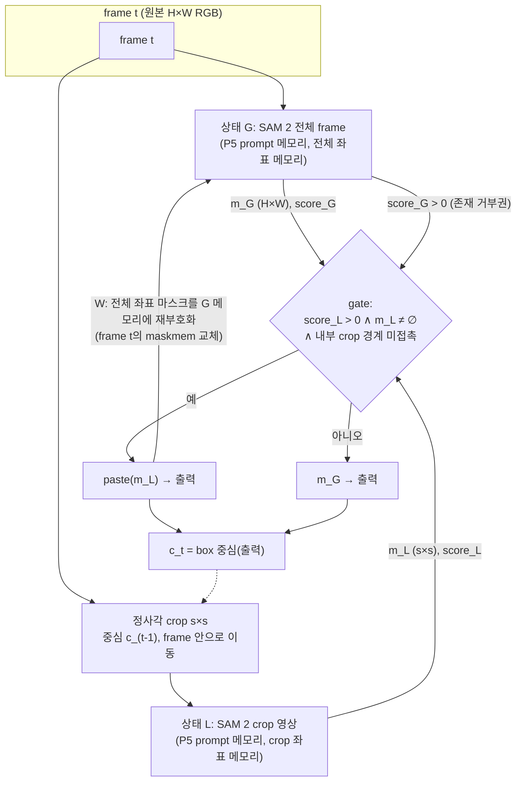

# 최종 알고리즘 명세: SGGL-V (Self-Gated Global–Local SAM 2 with cross-View presence reliability) + M7 ablation W

> **상태: 잠정 (PROVISIONAL).**
> - **M7 공동 1차 arm은 SGGL(= A2x)과 SGGL-V(= A2x + 전역 object score > 0 거부권, M6.1 A2v)다.**
>   - 거부권의 측정 이득은 객체 1개(miami-surf obj5)에서만 나온다. 그 객체를 빼면 A2x 대비 −0.0015 [−0.005, +0.001]이다.
>   - 극소 객체(< 0.1%)에서는 한 번도 발동하지 않았다.
>   - 개발 비열등: A2x 대비 −0.0009 (사전 기준 ≥ −0.003).
>   - 복제 세트(DAVIS train 41 / 22): +0.020 [+0.011, +0.029]. 단, 거부권은 이 세트에서 실패를 보고 만들었으므로 사후 근거다.
> - **기준선 SGGL(= M6 A2x):**
>   - 개발 세트 작은 객체 +0.018 [+0.009, +0.025], 영상 10개. 사전 관문 +0.03에는 미달했다.
>   - 같은 2× 계산의 F2 대비 +0.018 [+0.009, +0.026].
> - **W(M6.1 A3)는 기본값이 꺼진 ablation이다.**
>   - A2x 대비 +0.0022 [+0.0002, +0.0054]. 사전 조건 3개 중 2개가 미달했다(현직 + 0.01, 새 정보 +0.01 → 실제 +0.0002).
>   - 이득의 90%가 lab-coat 영상의 객체 3개에서 나왔다.
> - 둘 다 사후 탐색과 반복 사용한 개발 데이터에서 나왔다.
> - **비활성 동등성:**
>   - 되쓰기를 끄면(A2d) 기록된 A2x와 정확히 같다(21/21 객체).
>   - crop을 적용하지 않는 객체는 P5와 정확히 같다.

## 1. 구조



## 2. 데이터 흐름과 모양 (Hiera-T, 1024 입력)

| 단계 | 입력 | 출력 | 모양 |
|---|---|---|---|
| 배율 결정 (1회) | GT0 (H×W bool) | s = clamp(긴 변 / 0.25, min(H,W)/4, min(H,W)). s ≥ min(H,W)이면 L 없음 | 정수 |
| L frame 생성 | 원본 JPEG, box (y0, y1, x0, x1) | 정규화 텐서 | 3×1024×1024 (s×s를 resize) |
| G 한 frame | 3×1024×1024 (공식 로더) | 저해상도 logit 1×256×256 → H×W 마스크, object score, 메모리 (64×64×64 bf16) | — |
| L 한 frame | 3×1024×1024 (crop) | s×s 마스크, object score, crop 좌표 메모리 | — |
| gate | m_L, score_L, box | bool | — |
| 출력 | m_L 또는 m_G | H×W bool | — |
| W 되쓰기 | 출력 마스크 (H×W) | `detail.to_model` → 1×1×1024×1024 {0,1} → ±10 logit. `_run_memory_encoder(G, t)`로 frame t의 G 메모리 교체 | 64×64×64 bf16 |

## 3. 의사코드

```python
def sggl_v(frames, gt0, P, write_back=False):         # W는 M7 ablation, 기본 off
    H, W = gt0.shape
    s = crop_side(gt0, target=0.25, max_zoom=4)       # vcam.crop_side
    G = start_p5(P, frames, gt0)                       # m56.start(p5=True)
    if s is None:                                      # 큰 대상: P5와 동일
        yield from track(P, G); return
    c = box_center(gt0)
    Lf = LazyCropFrames(frames); Lf.box = place(c, s, (H, W))
    L = start_p5(P, Lf, gt0[box(Lf)], video_res=(s, s))   # m6.start_crop
    for t in 1..T-1:
        Lf.box = b = place(c, s, (H, W))               # t-1까지의 출력만 사용
        oG, mG, _, sG = step(P, G, t)                  # engine.predict + 저장
        oL, mL, _, sL = step(P, L, t)
        ok = sL > 0 and mL.any() and not touches_interior_edge(mL, b, (H, W)) and sG > 0   # V: 전역 존재 거부권
        out = paste(mL, b, (H, W)) if ok else mG
        if write_back and ok:                          # 한 방향만 (L → G)
            hi = to_model(out) * 20 - 10               # add_new_mask와 같은 resize
            oG.maskmem_features, oG.maskmem_pos_enc = P._run_memory_encoder(G, t, 1, hi, oG.object_score_logits, True)
        c = box_center(out) or c
        yield t, out
```

**금지와 주의:**
- G 마스크를 L 메모리에 쓰지 않는다. 양방향(A3s)은 lab-coat obj1에서 붕괴(−0.59)했다. 객체 1개이고 CI가 0을 포함하지만, 위험 신호로 본다.
- W는 G의 object score를 넘긴다. 그 값이 ≤ 0이면 SAM 2가 no-object embedding을 메모리에 더한다.
  - 개발 세트에서는 2,007 frame 중 1회였다.
  - 극소 대상 세트에서는 잦을 수 있다.
  - M7에서는 W를 'G score > 0일 때만'으로 제한한 변형도 함께 기록한다.
- **M7 W arm 3종:**
  1. W 끔 (주 알고리즘)
  2. W 항상
  3. 신뢰도 gate W: crop score와 G score가 모두 > 0이고, 되쓰기 직후 G score가 떨어지지 않을 때만
     - 지시서의 '신뢰도' 가설을 되쓰기 결정에 적용한 것이다.

## 4. 모듈 인터페이스 (현재 저장소 기준)

| 모듈 | 상태 | 인터페이스 |
|---|---|---|
| `src/spatial/vcam.py` | 있음 | `crop_side`, `place`, `paste`, `touches_border`, `center_of`, `LazyCropFrames`, `lazy_loader` |
| `scripts/m56.py:start/start_dir` | 있음 | P5 시작 |
| `scripts/m61.py:run_dual` | 있음 (실험용) | `(pred, set, unit, arm∈{A2d, A2v, A3, A3s}, n)` → (프레임 표, 마스크). A2d = SGGL, A2v = SGGL-V |
| **`src/spatial/sggl.py`** | **새로 만들 것 (M7)** | `SGGL(predictor, gate="self"|"self+presence"|"agreement"|"none", write_back="none"|"l2g"|"l2g_reliable")`. 기본값은 `self+presence`. `.start(frames_dir, gt0)`, `.step(t) -> (mask, info)`. 실험 코드에서 분리한 단일 구현 |

## 5. 상태 전이 (frame별)

| 상태 | 조건 | 출력 | 메모리 갱신 |
|---|---|---|---|
| NO_LOCAL | s 없음 (큰 대상) | m_G | G 기본 |
| LOCAL_ACCEPT | ok | paste(m_L) | L 기본. G 기본. (W arm에서만 G의 frame t 메모리를 출력으로 교체) |
| LOCAL_REJECT | ¬ok (crop object score ≤ 0, 경계 접촉, 빈 마스크, **또는 전역 object score ≤ 0**) | m_G | 둘 다 기본 (L은 자기 출력, G는 자기 출력) |

- crop 중심은 항상 출력 box 중심을 따른다.
- LOCAL_REJECT가 이어지면 crop이 G 출력 쪽으로 이동해 재획득한다(escape 복구).

## 6. 메모리 표현

- **G:** SAM 2 기본 메모리. 전체 frame 좌표이며 frame마다 maskmem 64×64×64 bf16과 obj_ptr를 갖는다.
  - W는 LOCAL_ACCEPT frame의 maskmem만 바꾼다.
  - obj_ptr는 바꾸지 않는다.
- **L:** SAM 2 기본 메모리. 고정 배율 crop 좌표이며, 팬만 하는 가상 카메라에 해당한다. 좌표 변환은 없다.
- **두 상태 간 교환:** W의 L→G 방향 하나뿐이다. 마스크가 이미 전체 좌표이므로 변환은 붙여 넣기뿐이다.

## 7. 계산량과 VRAM (RTX 2080, 측정값)

| | P5 | SGGL (A2x/A2d) | SGGL-W (A3) |
|---|---|---|---|
| 지연 (crop 적용 객체) | 0.208 s/frame | 0.430 s/frame | 0.436 s/frame (메모리 encoder 1회 추가) |
| 지연 (미적용 객체) | 0.208 | 0.208 | 0.208 |
| 최대 VRAM | 0.85–1.0 GB | 1.34 GB | 1.35 GB |
| 이미지 encoder 호출 | 1 / frame | 2 / frame | 2 / frame |

## 8. 실패 모드 (측정된 것)

| 실패 모드 | 관찰 위치 | 대응 |
|---|---|---|
| crop 이탈 (빠른 대상) | A1 motocross −0.114 | gate가 전역으로 되돌림. A2x에서 해결됨 |
| 과도한 확대로 문맥 상실 | A1z −0.044 | 배율 목표 0.25와 최대 4× 고정 |
| 예측 IoU가 확대 입력에서 과대 (극소 대상에서 +0.11) | M6.1 D1 | 예측 IoU를 gate에 쓰지 않음 |
| 양방향 메모리 피드백 붕괴 | A3s lab-coat obj1 −0.59 | 단방향만 허용 |
| 단방향 되쓰기의 피드백 위험 | A3에서는 관찰되지 않음 | 위험은 남아 있음. M7에서 붕괴 감지 지표(되쓰기 후 G object score 급락) 기록 |
| **진짜 부재 후 국소 오재획득 (확신)** | 복제 miami-surf obj5 −0.477 (crop score 최대 7.8, 전역은 부재로 판단) | **전역 존재 거부권 (V)** → +0.001 |
| 거부권의 대가: 전역이 극소 대상을 놓친 경우 | dog-gooses obj5 −0.056, kite-surf obj2 −0.013 등 | M7: 부재 후 재등장 순간에만 거부권, 또는 지속 시간 조건 |
| 얇은 줄 객체 (kite 줄, paragliding 줄) | box가 커서 crop 미적용 | 범위 밖. 출력 해상도 문제 |
| 확신에 찬 잘못된 영역 포착 (billie_shoes) | crop 미적용 큰 대상 | 범위 밖 |

## 9. 테스트와 ablation

**필수 테스트:**
- 이미 있는 것:
  - crop 미적용 = P5
  - A2d = 기록된 A2x
  - A3 인과성
  - identity crop = 공식 로더
- M7에서 추가할 것:
  - SGGL 모듈 단일 구현이 `run_dual`과 같은지
  - 되쓰기 후 G 메모리 텐서의 모양과 dtype
  - 상태 격리 (L 메모리 id에 G 쓰기가 없는지)

**ablation (M7, 새 데이터의 개발 절반):**

| # | 비교 | 질문 |
|---|---|---|
| 1 | gate: self / agreement(CTU) / none | 수용 gate 효과 (M6: self − CTU +0.008) |
| 2 | 되쓰기: 없음 / L→G / 양방향 | W 효과와 방향성 (M6.1: +0.002 / −0.036) |
| 3 | 배율 목표 0.25 / 0.35. 최대 4× / 8× | 극소 대상의 배율 제한 |
| 4 | 비용 대조: F2 flip 앙상블, 같은 2× 계산 | 효과가 메커니즘에서 오는지, 계산량에서 오는지 |
| 5 | Hiera-T / Hiera-L | backbone 의존성 |
| 6 | CTU 원형 재현 (H/4, H/2 병렬) | 최근접 선행연구 기준선 |
